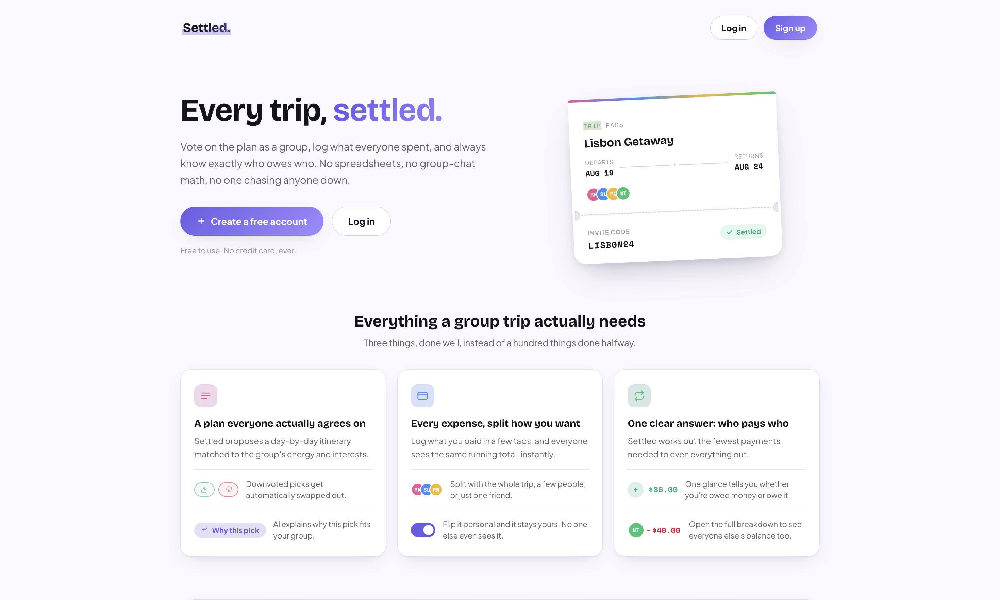

# Settled

**Group trip planning without the group-chat chaos.** Vote on the plan together, split what everyone spent, and see exactly who owes who.

<p align="center">
  
</p>

## Features

- **Smart itinerary**: generates a morning/afternoon/evening plan for every day, matched to the group's budget, energy level and interests.
- **Group voting**: a majority upvote locks an activity. A majority downvote swaps in the next best one automatically.
- **AI "Why this pick?"**: a Gemini-powered one-liner explaining why an activity suits your group. If the AI is down, the app keeps working.
- **Expense splitting**: split any cost between everyone or a chosen few, accurate to the cent.
- **Settle up**: turns everyone's balances into a short list of payments.
- **Invite codes**: friends join a trip with a single code.

## Tech

**PHP · MySQL · JavaScript · HTML/CSS · Gemini API**

Built without frameworks · prepared statements · bcrypt passwords · server-side API key

## Project structure

```
settled/
├── settled-client/
│   ├── pages/        # app pages
│   ├── scripts/      # page logic
│   └── styles/       # stylesheets
└── settled-server/
    ├── algorithms/   # itinerary matching, settle up
    ├── api/          # JSON endpoints
    ├── config/       # API key config
    └── database/     # schema and seed data
```
